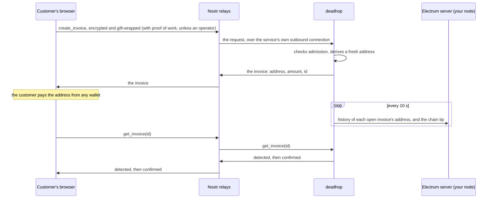
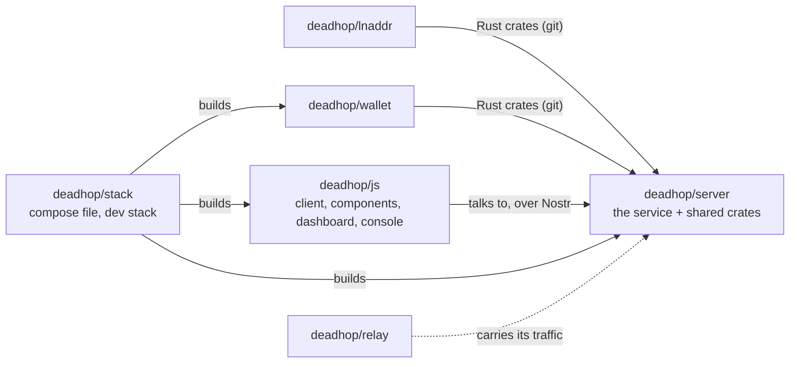

<div align="center">

<picture>
  <source media="(prefers-color-scheme: dark)" srcset="https://deadhop.run/docs/mark-fog.svg">
  
</picture>

# deadhop

**Dials out. Never listens.**

On-chain bitcoin payments from a service with no open port.

[](https://github.com/deadhop/server/actions/workflows/ci.yml)
[](#develop)
[](LICENSE)
[](https://deadhop.run/docs/)

<picture>
  <source media="(prefers-color-scheme: light)" srcset="https://deadhop.run/shots/payments-overview-light.webp">
  
</picture>

<sub>The operator Overview on a test chain (regtest), not a live shop.</sub>

</div>

This is the payment service. It runs next to your bitcoin node, issues invoices, watches the
chain and reports payments, much as BTCPay Server does for simple invoicing. It never listens on
a port: customers and operators reach it only through Nostr relays, using
[ContextVM](https://contextvm.org) (MCP over Nostr). There is no IP address, HTTP endpoint or
login form to attack. It holds only a watch-only account key, so it cannot spend what it
receives.

## How a payment works



Every message is NIP-44 encrypted to the recipient and gift-wrapped (NIP-59). Relays see only
ciphertext. The customer never talks to the service directly, and the payment itself never
touches it: they send bitcoin to the address.

| State | Meaning |
| --- | --- |
| `pending` | Waiting for payment |
| `detected` | The full amount has been seen, not yet with enough confirmations |
| `confirmed` | The full amount has at least `DEADHOP_MIN_CONFIRMATIONS` confirmations. Final. |
| `expired` | The lifetime passed before the full amount was seen |

`detected` means seen, not paid: release goods only on `confirmed`. The details, including
who may create invoices and how payments are checked, are in
[How it works](https://deadhop.run/docs/how-it-works.html).

<p align="center">
  
</p>

## Run it

The easiest way is Docker Compose from [deadhop/stack](https://github.com/deadhop/stack): it
runs the service, an offline wallet that can generate your wallet for you, and the dashboard.

```sh
git clone https://github.com/deadhop/stack && cd stack
# write .env (see the guide), then:
docker compose up -d --build
```

| Start here | |
| --- | --- |
| [Choose a setup](https://deadhop.run/docs/install.html) | How it runs, where payments land, who creates invoices |
| [Your first real payment](https://deadhop.run/docs/first-payment.html) | Compose next to your node, a generated wallet, an invoice paid and seen in Sparrow |
| [Docker Compose](https://deadhop.run/docs/deploy-compose.html) / [systemd](https://deadhop.run/docs/deploy-systemd.html) | The two ways to run it |
| [Connect your Electrum server](https://deadhop.run/docs/electrum.html) | Fulcrum or electrs, TLS pinning with `deadhop fingerprint` |
| [Hide the service](https://deadhop.run/docs/hide.html) | Proxies, Tor, the offline policy, `DEADHOP_PROXY_LOCKED` |
| [Production checklist](https://deadhop.run/docs/deployment.html) | Everything to check before the first real payment |
| [Configuration](https://deadhop.run/docs/configuration.html) / [Commands](https://deadhop.run/docs/cli.html) / [API](https://deadhop.run/docs/api.html) | Every setting, command and tool |

To build only this repository: `docker build -t deadhop .`, or `cargo build --release --locked`.

## Performance

Measured on an Apple M4 Max against a local, ephemeral relay, so the numbers describe the
service rather than a relay.

| Workload | Clean (no loss, p99 < 100 ms) | Losing requests from | Crashed? |
| --- | --- | --- | --- |
| `get_info` | 3,000/s (180,000/min) | 4,000/s (6.1% unanswered) | No, up to 8,000/s |
| `get_invoice` | 3,000/s (180,000/min) | 4,000/s (2.5% unanswered) | No, up to 8,000/s |
| `create_invoice` | 200/s (12,000/min) up to about 24,000 open invoices | 400/s (35.8% unanswered once about 35,000 are open) | No, up to 3,200/s |
| Default limits | 1,200/min, as configured | none: extra calls are refused with `rate_limited` | No |

No request rate crashed the service: past its capacity it drops the excess and recovers as
soon as the load falls.

## The deadhop repositories



| Repository | What it holds |
| --- | --- |
| **deadhop/server** (this one) | The payment service, and the shared crates the other Rust tools build on |
| [deadhop/js](https://github.com/deadhop/js) | `@deadhop/client`, `@deadhop/react`, `@deadhop/solid`, `@deadhop/svelte`, the dashboard and the console |
| [deadhop/stack](https://github.com/deadhop/stack) | The Docker Compose file, and the regtest stack for development |
| [deadhop/lnaddr](https://github.com/deadhop/lnaddr) | A Lightning address (LUD-16) for a node with no public address |
| [deadhop/relay](https://github.com/deadhop/relay) | A Nostr relay that carries one deadhop service's traffic and nothing else |
| [deadhop/wallet](https://github.com/deadhop/wallet) | The optional sweeper: send, PayJoin or CoinJoin to your cold wallet |
| [deadhop/site](https://github.com/deadhop/site) | https://deadhop.run and every component's docs |
| [deadhop/brand](https://github.com/deadhop/brand) | Logo, icons, fonts and the brand guide |

## Develop

Requirements: Rust 1.99, [`just`](https://github.com/casey/just) and
[`cargo-llvm-cov`](https://github.com/taiki-e/cargo-llvm-cov).

```sh
just check           # rustfmt, clippy -D warnings, tests with 100% lines and functions: the service and each crate
just test            # the service's tests with the coverage gate
just live-electrum   # read-only check of a real Electrum server named in .env.local (gitignored)
```

Unit tests are hermetic: an in-process relay, a scripted Electrum server (plain and TLS), and
in-process SOCKS5, HTTP and HTTPS proxies. Real payments on regtest (bitcoind, Fulcrum, a relay
and Chrome) run from [deadhop/stack](https://github.com/deadhop/stack): `just clone`, `just up`,
`just server`, `just e2e`.

```
.
├── crates/         shared crates: tlspin, net, cvm, electrum, common, netengine
├── fixtures/       route-patterns.json: the routing contract shared with @deadhop/network-ui
├── src/            app, config, db, manage, mcp, pow, service, settings, …
├── tests/          binary tests, live Electrum and I2P tests, snapshots, fixtures
├── vendor/rmcp/    rmcp 1.8.0 with the response-task reaping fix backported from 3.x
├── Cargo.toml
├── Dockerfile
├── justfile
└── SECURITY.md
```

**The crates are used by other repositories.** deadhop/lnaddr and deadhop/wallet depend on
`crates/*` and `vendor/rmcp` through git. A change to a crate's public API needs a follow-up
there: after it merges, they move with `just update-server-crates`. Each crate has its own
`Cargo.lock` and its own 100% gate in `just check`.

**`fixtures/route-patterns.json` is a contract.** deadhop/js keeps a copy for
`@deadhop/network-ui`'s tests. Change both together.

## Not built yet

- SPV verification (merkle proofs against a header chain), to trust the Electrum server less.
- Push notifications instead of polling; webhooks for shop back ends.
- An invoice-only key role, so a shop back end can create invoices without a key that can also
  manage the service. Today that takes an operator key.
- Taproot (BIP-86) receive addresses.

## Security

[SECURITY.md](SECURITY.md) has the threat model, the findings and their status, the
remote-management rules, the open risks and the deployment checklist.

## Contributing

Issues and pull requests are welcome here. CI runs `just check` on every pull request; run it
before you push. Doc changes go to [deadhop/site](https://github.com/deadhop/site).

## License

[MIT](LICENSE).
