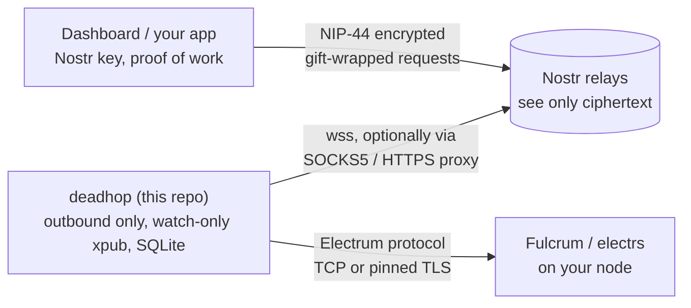

<div align="center">

# deadhop

**Dials out. Never listens.**

On-chain bitcoin payments from a service with no open port.

[](LICENSE)


</div>

This is the payment service. It runs next to your bitcoin node, issues invoices, watches
the chain and reports payments. It never listens on a port: customers and operators reach
it only through Nostr relays, using [ContextVM](https://contextvm.org) (MCP over Nostr). It
holds only a watch-only account key, so it cannot spend what it receives.



## The deadhop repositories

| Repository | What it holds |
| --- | --- |
| **deadhop/server** (this one) | The payment service, and the shared crates the other Rust tools build on |
| [deadhop/js](https://github.com/deadhop/js) | `@deadhop/client`, `@deadhop/react`, `@deadhop/solid`, `@deadhop/svelte`, the dashboard and the console |
| [deadhop/lnaddr](https://github.com/deadhop/lnaddr) | A Lightning address (LUD-16) for a node with no public address |
| [deadhop/relay](https://github.com/deadhop/relay) | A Nostr relay that carries one deadhop service's traffic and nothing else |
| [deadhop/wallet](https://github.com/deadhop/wallet) | The optional sweeper: send, PayJoin or CoinJoin to your cold wallet |
| [deadhop/site](https://github.com/deadhop/site) | https://deadhop.run and the docs |
| [deadhop/brand](https://github.com/deadhop/brand) | Logo, icons, fonts and the brand guide |

## Run it

The guides are at https://deadhop.run/docs/ (source in [deadhop/site](https://github.com/deadhop/site)):

| Start here | |
| --- | --- |
| [Choose a setup](https://deadhop.run/docs/install.html) | How it runs, where payments land, who creates invoices |
| [Your first real payment](https://deadhop.run/docs/first-payment.html) | Compose next to your node, a generated wallet, an invoice paid and seen in Sparrow |
| [Docker Compose](https://deadhop.run/docs/deploy-compose.html) / [systemd](https://deadhop.run/docs/deploy-systemd.html) | The two ways to run it |
| [Connect your Electrum server](https://deadhop.run/docs/electrum.html) | Fulcrum or electrs, TLS pinning with `deadhop fingerprint` |
| [Hide the service](https://deadhop.run/docs/hide.html) | Proxies, Tor, the offline policy, `DEADHOP_PROXY_LOCKED` |
| [Production checklist](https://deadhop.run/docs/deployment.html) | Everything to check before the first real payment |
| [Configuration](https://deadhop.run/docs/configuration.html) / [Commands](https://deadhop.run/docs/cli.html) / [API](https://deadhop.run/docs/api.html) | Every setting, command and tool |

```sh
docker build -t deadhop .      # or: cargo build --release --locked
```

## Develop

Requirements: Rust 1.99, [`just`](https://github.com/casey/just) and
[`cargo-llvm-cov`](https://github.com/taiki-e/cargo-llvm-cov).

```sh
just check           # rustfmt, clippy -D warnings, tests with 100% lines and functions: the service and each crate
just test            # the service's tests with the coverage gate
just live-electrum   # read-only check of a real Electrum server from .env.local (gitignored)
```

Unit tests are hermetic: an in-process relay, a scripted Electrum server (plain and TLS),
and in-process SOCKS5, HTTP and HTTPS proxies. End-to-end payment tests on regtest (real
bitcoind, Fulcrum, relay and Chrome) need the development stack and the JavaScript
packages together; they run from the deadhop workspace.

### Layout

```
.
├── crates/      shared crates: tlspin, net, cvm, electrum, common, netengine
├── fixtures/    route-patterns.json: the routing contract shared with @deadhop/network-ui
├── src/         app, config, db, manage, mcp, pow, service, settings, …
├── tests/       binary tests, live Electrum and I2P tests, snapshots, fixtures
└── vendor/rmcp  rmcp 1.8.0 with the response-task reaping fix backported from 3.x
```

**The crates are used by other repositories.** deadhop/lnaddr and deadhop/wallet depend on
`crates/*` and `vendor/rmcp` through git. A change to a crate's public API needs a
follow-up there: after it merges, run `cargo update -p <crate>` in each consumer. Each
crate has its own `Cargo.lock` and its own 100% gate in `just check`.

**`fixtures/route-patterns.json` is a contract.** deadhop/js keeps a copy for
`@deadhop/network-ui`'s tests. Change both together.

## Security

[SECURITY.md](SECURITY.md) has the threat model, findings and their status, the
remote-management rules, open risks and the deployment checklist.

## License

[MIT](LICENSE).
